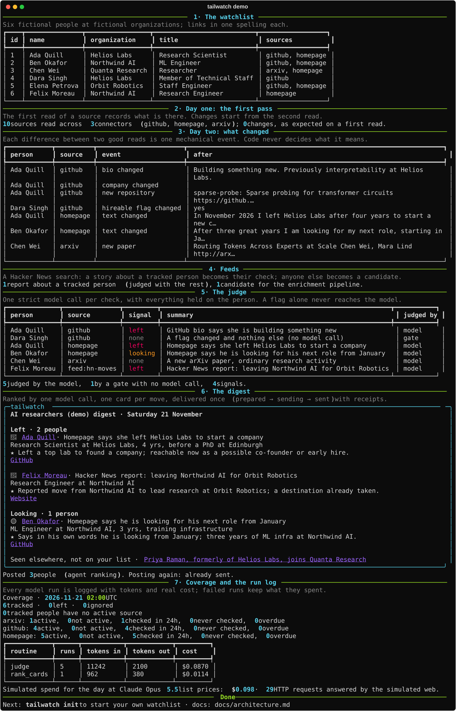
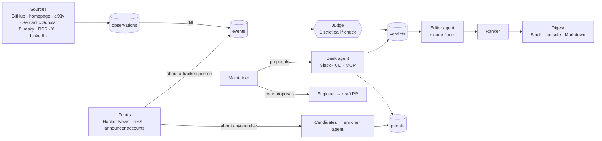

<div align="center">

# tailwatch

**An agent harness that tracks any set of people across the web, judges what changed, verifies it, and sends you one digest a day.**

[](https://github.com/ShouryaGodha/tailwatch/actions/workflows/ci.yml)


[Quickstart](#quickstart) · [How it works](#how-it-works) · [Architecture](docs/architecture.md) · [Connectors](docs/connectors.md) · [Signal packs](docs/signal-packs.md) · [Deploy](docs/deploy.md)



<sub><code>tailwatch demo</code> · runs with no keys · <a href="docs/assets/demo-full.svg">the full run</a> (watchlist, two days of reads, feeds, judge, digest, desk, maintainer, run log)</sub>

</div>

Give tailwatch a list of people: researchers you would hire, maintainers whose work you follow,
founders you would back. It reads their public footprint every day (GitHub, personal sites,
arXiv, Semantic Scholar, Bluesky, blogs, and optionally X and LinkedIn) and watches news
feeds for reports about them. Each change becomes a mechanical event. One model call per check
decides what it means. An editor agent verifies the card against fresh evidence. A ranker
orders the day, and you get one message, in Slack, your terminal or a Markdown file:

```
AI researchers digest · Saturday 21 November

Left · 2 people
🔴 Ada Quill · Homepage says she left Helios Labs to start a company
Research Scientist at Helios Labs, 4 yrs, before a PhD at Edinburgh
★ Left a top lab to found a company; reachable now as a possible co-founder or early hire.

🔴 Felix Moreau · Hacker News report: leaving Northwind AI for Orbit Robotics
Research Engineer at Northwind AI
★ Reported move from Northwind AI to lead research at Orbit Robotics; a destination already taken.

Looking · 1 person
🟡 Ben Okafor · Homepage says he is looking for his next role from January
ML Engineer at Northwind AI, 3 yrs, training infrastructure

Seen elsewhere, not on your list · Priya Raman, formerly of Helios Labs, joins Quanta Research
```

"Career moves" is one **signal pack**. Swap it for `research-output` (new papers, releases,
announcements), `founder-watch` (founding, raised, launched) or [your own](docs/signal-packs.md).
The judge's prompt and its answer schema are built from the pack.

## Quickstart

```bash
uv tool install "tailwatch[slack,mcp] @ git+https://github.com/ShouryaGodha/tailwatch"

tailwatch demo                              # the whole pipeline on a simulated world: no keys, no cost
tailwatch init --preset ai-researchers      # writes tailwatch.yaml, .env and watchlist.csv
tailwatch doctor                            # checks keys, connectors and the signal pack
tailwatch up                                # a tick every 30 minutes, one digest a day
```

You need one model key (`ANTHROPIC_API_KEY` by default; OpenAI, Azure OpenAI, OpenRouter and
local Ollama also work). Every built-in source except X and LinkedIn is free.

## How it works



- **Connectors** read one source of one person (`checker`) or a stream about anyone (`feed`).
  A first read records only. "Gone" counts after two reads in a row. Five failures move a
  source to weekly retries. A read that looks like a change but is a failed read is rejected.
  [Write your own](docs/writing-a-connector.md) as a separate package.
- **The judge** makes one strict, structured call per check, with everything held on the person
  (the newest read of each source, the last two weeks of changes, earlier signals, team
  intel). Code never decides what a change means. It only gates flag-only changes, refuses
  signals dated too long ago and ids the history does not hold, and parks a check after three
  bad answers.
- **The editor** checks each card against fresh evidence with read-only tools. Five floors in
  code (identity, the change is still there, the label is supported by a verbatim quote, not a
  duplicate, confidence) **can only lower** its verdict.
- **The digest** carries one card per move, ranked by one model call, and is delivered exactly
  once (prepared → sending → sent, reconciled by message key after a crash).
- **The desk** is a chat agent in Slack, the terminal (`tailwatch ask`) or any MCP client. It
  has core tools plus [skills](skills/) it loads on demand: verification, enrichment, intel,
  data, maintenance and engineer. Writing tools need a person on the team list.
- **The custodian** turns data problems into issues and runs only allow-listed, idempotent
  playbooks.
- **The maintainer** reads the day once (outcomes, failed floors, spend, the judge's samples,
  the holdout score), grades the agents' answers and proposes changes. **It applies nothing.** A
  person replies `apply P3`.
- **The engineer** (off by default) turns a code proposal into a **draft pull request** in a
  sandboxed checkout, with tests, a secret scan and a fresh-session review. It never merges.

## The harness

tailwatch is also a compact, readable agent harness. Everything above runs on four pieces:

| Piece | File | What it guarantees |
|---|---|---|
| One model client | [`agent/model.py`](src/tailwatch/agent/model.py) | `provider:model` across Anthropic, OpenAI, Azure, OpenRouter and Ollama; retries; key failover; real cost from a price table |
| One agent loop | [`agent/loop.py`](src/tailwatch/agent/loop.py) | step, time and **dollar** caps; stuck detection; outside text wrapped as `<evidence>`; memoised writes; checkpoints; failed runs keep their spend |
| One tool registry | [`agent/registry.py`](src/tailwatch/agent/registry.py) | every tool defined once, with flags; **one** permission check for writes |
| Skills | [`agent/skills.py`](src/tailwatch/agent/skills.py) | [Agent Skills](https://agentskills.io) format, loaded on demand, with versioned learned rules appended at run time |

Every model run, whether a routine, a chat message or a judge call, is a row in the run log
with its tokens and real cost (`tailwatch runs`). The daily budget caps sum that one ledger.

### Design principles

1. **Code can only lower an agent's verdict.** Agents conclude. Deterministic floors and proof
   checks can turn a confirm into a hold, never the reverse.
2. **Append-only history.** Observations, events, verdicts and setting versions are never
   rewritten. A person's correction is a newer verdict.
3. **Agents propose, people apply.** Rules, statuses, removals and code changes all wait for a
   person.
4. **Outside text is evidence, never instructions.**
5. **Budgets are real money**, and that includes runs that failed.
6. **Say it once.** One digest a day, and each notice once a day.

The reasons behind each rule are in [docs/architecture.md](docs/architecture.md#why-it-is-built-this-way).

## Use it from Claude Code (MCP)

```bash
claude mcp add tailwatch -- tailwatch mcp
```

Then ask: *"Who on my list moved this week, and what is the evidence for Ada?"* The tools are
`find_people`, `person`, `signals`, `why`, `digest_preview`, `coverage`, `runs`, `add_person`,
`set_status`, `remember` and `ask_desk`, the last being the desk agent with every skill.
Configs for other clients are in [docs/deploy.md](docs/deploy.md#the-mcp-server).

## Commands

| | |
|---|---|
| `tailwatch demo` | the whole pipeline on a simulated world |
| `tailwatch init` · `doctor` | start a project and check it |
| `tailwatch add <urls> -n "Name"` · `import people.csv` · `people` · `person ada` | the watchlist |
| `tailwatch check` · `watch` · `judge` | a source pass, the feeds, the judge |
| `tailwatch digest` · `digest --post` | preview, or deliver once with receipts |
| `tailwatch ask "why Ada?"` | the desk agent in your terminal |
| `tailwatch coverage` · `runs` · `run <id>` | who is watched; what every run cost |
| `tailwatch verify` · `maintain` · `score` · `engineer "<task>"` | the editor, the maintainer, the holdout score, the engineer |
| `tailwatch up` · `tick` · `slack` · `mcp` | run forever, one tick, the Slack bot, the MCP server |

## Deploy

Run it on your laptop (`tailwatch up`), on any server (`docker compose up -d`), on a GitHub
Actions schedule with no server at all, or on Modal. See [docs/deploy.md](docs/deploy.md).
SQLite is the default; Postgres is one line in `tailwatch.yaml`.

## Docs

[Architecture](docs/architecture.md) · [Configuration](docs/configuration.md) ·
[Signal packs](docs/signal-packs.md) · [Connectors](docs/connectors.md) ·
[Writing a connector](docs/writing-a-connector.md) · [Enrichment](docs/enrichment.md) ·
[The engineer](docs/engineer.md) · [Deploy](docs/deploy.md) · [Safety](docs/safety.md)

## Responsible use

tailwatch reads public information about people. It never contacts anyone, and your data stays
in your database. Check that your use complies with each platform's terms and with privacy law
where you are. See [docs/safety.md](docs/safety.md).

## Development

```bash
git clone https://github.com/ShouryaGodha/tailwatch && cd tailwatch
uv venv && uv pip install -e ".[all]" pytest ruff
pytest -q && ruff check .        # offline: scripted models, recorded HTTP, in-memory SQLite
```

[AGENTS.md](AGENTS.md) is the contributor guide, for people and coding agents alike.

## License

MIT
