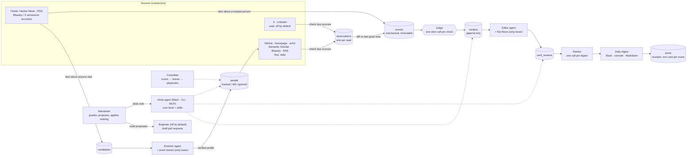
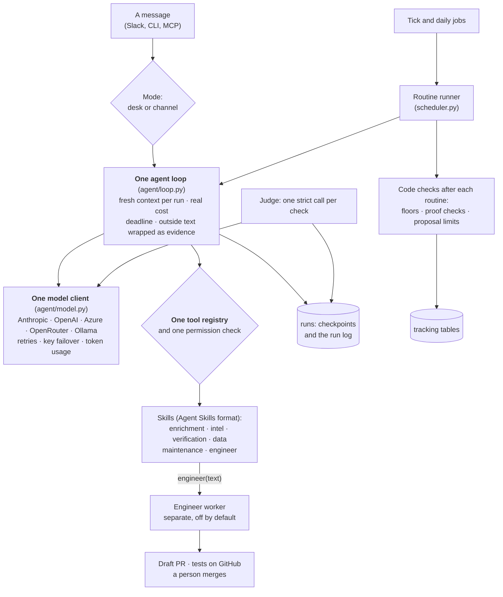

# Architecture

tailwatch is small in concepts and strict in its rules. There are five tables that matter, one
model client, one agent loop, one tool registry and a handful of agents that share them.

## The data flow

- **people** is the watchlist. Nobody is deleted: a person is `tracked`, `left` or `ignored`.
  Removed people are remembered in `removals`, so an import never adds them back. Every link
  is stored in one spelling (`person_links`), so nobody is listed twice.
- **sources** are one row per (person, kind, url). Each has a cadence, a next-due time, a
  failure streak and a status (`active`, `broken`, `private`, `wrong_person`, `paused`).
- **observations** are one row per read of a source. A read that finds nothing new still
  writes a row, because that is what "checked" means.
- **events** are one row per difference between two good reads: "bio changed", "new paper",
  "role ended". The labels are mechanical. Code never decides what a change means.
- **verdicts** are one judgement per check, and they are append-only. A person's correction
  is a newer verdict that supersedes the model's without erasing it.

## The one agent

### The model client (`agent/model.py`)

Every model call in tailwatch goes through `call(Request)`:

- Models are named `provider:model`. Anthropic is the default, through the official SDK with
  its own retries turned off. OpenAI, Azure OpenAI, OpenRouter, Ollama and any
  OpenAI-compatible server go through Chat Completions.
- A rate limit moves to the next key (`ANTHROPIC_API_KEY=a,b,c` or `ANTHROPIC_API_KEY_1..20`)
  before any wait. Retryable errors (429, 5xx, timeouts) are retried twice with backoff.
  400, 401, 403 and 422 are never retried.
- Usage is priced from the table in `agent/pricing.py`, plus your `pricing:` in
  `tailwatch.yaml`. An unknown model is still called; its runs are marked unpriced, never $0.
- Provider-wide refusals (no credits, every key rejected) carry an `outage` reason, so a pass
  stops after 15 identical failures instead of failing check by check.
- Claude-specific details: structured answers use `output_config.format`, depth uses
  `output_config.effort`, and the system prompt carries a cache breakpoint. Thinking blocks
  are passed back unchanged within a run. On models that support it, a policy refusal is
  retried server-side on a fallback model (`TAILWATCH_REFUSAL_FALLBACK=off` turns this off).

### The loop (`agent/loop.py`)

`run(spec, messages)` runs a routine until it answers or a cap stops it:

| Rule | Why |
|---|---|
| Steps, deadline and real-cost budget, checked before every model call and every tool | A run can never spend more than its cap, in time or money |
| The same call twice gets a note; four times, or six calls alternating between two shapes, stops the run | Stuck agents stop early |
| N tool errors in a row stop the run | Broken tools do not burn the budget |
| A tool raising `ToolStop(NEED_KEY \| RATE_LIMITED \| BUDGET)` ends the run | A provider saying no is not the agent's problem to solve |
| Tool results flagged `evidence` are wrapped in `<evidence>` tags, with closing tags in the text defanged | A web page cannot end the wrapper and speak as the system |
| Results are capped per tool, and the oldest are trimmed past a run total | Context stays bounded |
| Writing tools are memoised by operation hash | A resumed run never writes twice |
| A checkpoint is taken after every turn | A retried Slack event resumes instead of answering twice |
| A stopped routine that must answer gets one final answer-only call | Workers return what they have |
| A failed run carries its spend on the exception (`failed_run`) | The run log never says $0 for paid calls |

### The registry (`agent/registry.py`)

Tool modules declare `TOOLS = Toolbox(owner)` and decorate their handlers. Owners are
`channel`, `core` or a skill's name. The registry imports every module in `MODULES`, and a
name defined twice is an error. `execute` is the only place permission is checked: a `writes`
tool needs a person on the team list (`team:` in the config plus `DESK:TEAM` in settings). An
empty list lets everyone write unless `require_team_list: true`. The same registry feeds the
Slack modes, the CLI desk (`tailwatch ask`) and the MCP server.

### Skills (`agent/skills.py`, `skills/`)

Skills follow the [Agent Skills](https://agentskills.io/specification) format, so each folder
also loads in Claude Code or the Claude API. The desk's prompt carries only the index (name
and description). `use_skill(name)` returns the body, and the skill's tools are offered from
the next step on. Learned rules are versioned settings that a person applied from a
maintainer's proposal, and they are appended to the body at run time. They are never written
into the file.

### Routines (`agent/routines.py`)

| Routine | Tools | Answer | Code after it |
|---|---|---|---|
| `judge` | none | the pack's signal schema | gates, old-move guard, id check, roster follow, park after 3 bad answers |
| `verify_card` (the editor) | read-only web, profile and list tools | confirm, fix, hold or drop with quotes | five floors that can only lower |
| `enrich_person` | read-only web, profile and list tools | links with verbatim proof | proof checks that can only lower |
| `identify_mention` | none | who a post is about | the scope filter and dedupe |
| `rank_cards` | none | order and one reason per person | falls back to a deterministic sort |
| `daily_review` (the maintainer) | none | grades, lessons, proposals, issues | proposal limits; applies nothing |
| `desk`, `channel` | core plus skills / channel tools | text | the permission check on every write |
| `engineer` | sandboxed file and test tools | a diff | path allow-list, secret scan, tests, a reviewer session, draft PR only |

Every routine run is a row in `runs` with its model, tokens, cost (model plus tools) and how it
ended. The daily caps sum that one ledger.

## The schedule

`tailwatch up` runs a tick every 30 minutes. `tailwatch tick` runs one tick, for cron, GitHub
Actions or Modal.

| Job | When | What |
|---|---|---|
| `watch` | every tick | new feed items: reports about tracked people are judged; others become candidates |
| `candidates` | every tick | identify, filter, enrich, then add or send to review |
| `judge` | every tick | anything waiting |
| `verify` | every tick | the editor over the cards the next digest could list |
| `custodian` | every tick | open issues with a known playbook, 30 a tick |
| `links_enrich` | daily, 20 minutes before the pass | missing links for newcomers |
| `pass` | daily at `pass_time` | every due source, then the judge |
| `digest` | daily at `digest_time` | the digest (and, in shadow mode, the verified-only trial first) |
| `maintenance` | daily at `maintenance_time` | the maintainer's review and the desk note |

A daily job keeps a receipt per local day. A failed job is retried on later ticks, three
attempts in all, and a job that failed three times is reported once.

## Why it is built this way

The design comes from running a private version of this system on tens of thousands of people.
The rules in [AGENTS.md](../AGENTS.md) each answer a failure that happened:

- **Several classifiers disagreed.** So there is one judge, one call per check, and no regex
  second-guessing its prose.
- **Verdicts were overwritten, and departures vanished.** So history is append-only.
- **Glitches at providers looked like departures.** So a source counts as gone only after two
  gone reads in a row, and guards reject failed reads that look like changes.
- **A run that failed showed $0** although its calls were paid. So failed runs carry their
  spend.
- **The same move was posted three times from three sources.** So the receipts enforce one
  card per move.
- **An agent "fixed" things nobody asked it to fix.** So agents propose and people apply. The
  maintainer applies nothing, the custodian runs only allow-listed playbooks, and the engineer
  opens draft pull requests.
